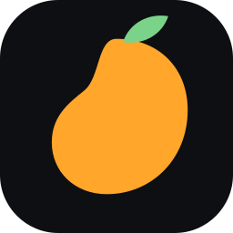
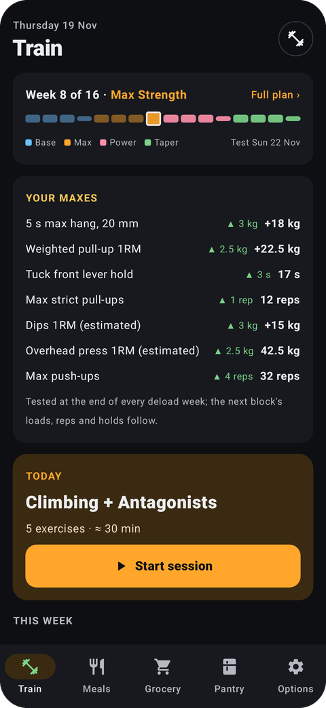
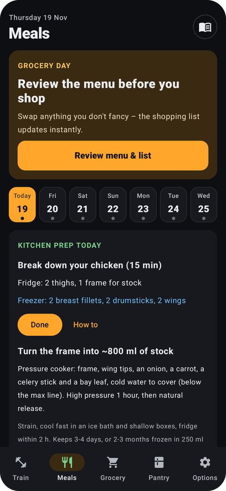
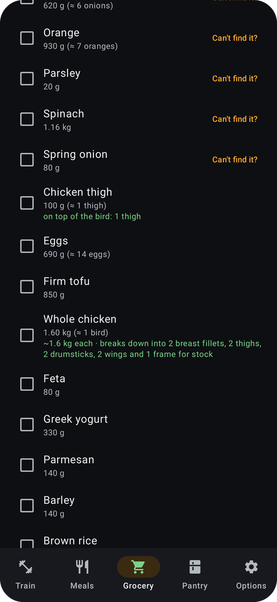
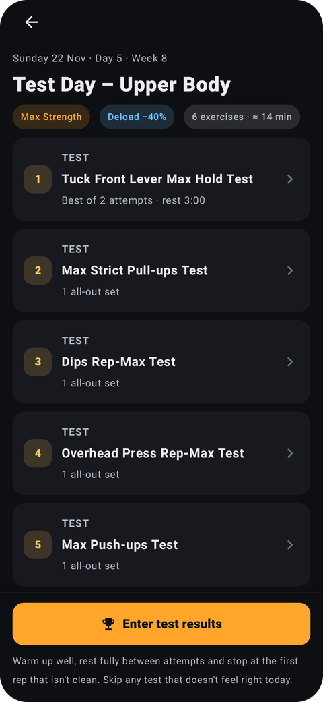
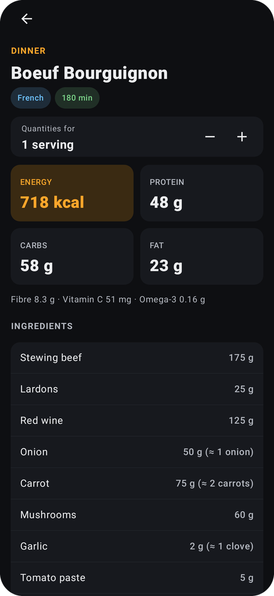
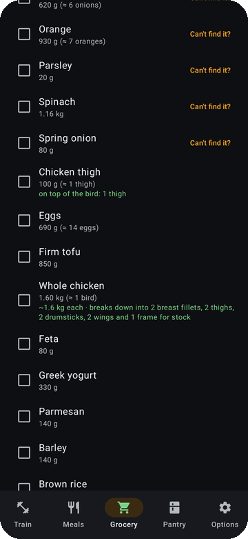
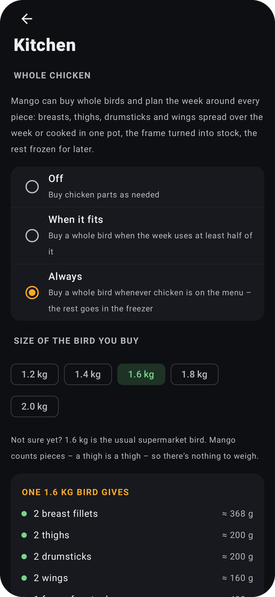

  

<h1 align="center">Mango</h1>

  <b>Your climbing training, meals and groceries planned for you, on your phone, without internet.</b> 
  A periodized program that adapts to your tested maxes, a zero-waste meal planner with 163 portion-checked recipes, and one shopping list. No account, no server, no tracking.

  
  
  
  
  
  

  <a href="#install-in-30-seconds">Install</a> ·
  <a href="#features">Features</a> ·
  <a href="#your-first-week">First week</a> ·
  <a href="#faq">FAQ</a> ·
  <a href="docs/training.md">Training science</a> ·
  <a href="docs/meals.md">Meal planner</a> ·
  <a href="https://github.com/Vagharlix/Mango/issues">Report a bug</a>

  
  
  

## Install in 30 seconds

1. Download **Mango-vX.Y.Z.apk** from the [latest release](https://github.com/Vagharlix/Mango/releases/latest).
2. Open it on your phone (Android 8.0 or newer). Allow installing unknown apps if your phone asks.
3. Create your profile: age, height, weight, goal. The program and the week's menu are ready right away.

To update, install the new version over the old one: your data stays.

## Features

### Training that follows your real strength

  

- **Periodized program**: Base, Max Strength, Power or Endurance, then Taper, in fixed-length programs or an endless 16-week cycle. Every 4th week is a deload.
- **Test days built in**: the end of every deload week measures your max hang, weighted pull-up, pull-ups, dips, overhead press, push-ups and front lever. The first week calibrates anything you have never tested.
- **Loads that adapt**: from the day after a test, hangboard and pull-up loads are a % of your 1RM, push-ups and pull-ups a share of your max reps, front lever holds a share of your best hold.
- **Antagonists every week**: presses, dips, push-ups, wrist and finger extensors, shoulder health work.
- **Your equipment**: tick what you have (hangboard, wall, rings, weights, dumbbells…). Anything missing is replaced by the closest alternative.
- **Guided timer**: a whole session runs hands-free, with beeps and vibrations, even with the screen off.

### Meals that match your training

  

- **Daily targets from your phase**: calories, protein (1.6 to 2.2 g/kg), carbs, fat, fibre, vitamin C and omega-3 follow the training block.
- **Zero waste**: recipes are chosen for what's in your pantry and what expires first. Skip a meal and the next days use up its ingredients.
- **Simple weeks**: long recipes are batch cooked for 2 to 4 meals, 2 breakfasts rotate, and interchangeable foods are merged, so a typical week has about a third fewer different items to buy.
- **Never the same dish two days in a row**, and your choices of carbs (rice, pasta, potatoes…) and meats are respected.
- **163 recipes** sized for one person, including French, Italian, Japanese, Chinese and Southeast Asian classics with a link to the original. Remove any recipe in one tap, write your own.

### A smarter shopping list

  
  

- **Whole chicken**: Mango can buy whole birds and plan every piece: breasts, thighs, drumsticks and wings over the week or in one pot, the frame turned into stock, the rest frozen. Pieces are counted, not weighed.
- **Kitchen prep card**: how to break down the bird, when to make stock, what to thaw tonight, what to freeze before it goes off.
- **Barcode pantry**: scan products into the pantry. Unknown barcodes are looked up on Open Food Facts once, then work offline.
- **Spice rack**: spices, sauces and stock you keep stocked never clutter the list.
- **Can't find it?**: pick a replacement in the shop and the week's meals follow.

### Works offline

Everything runs on the phone: the program, the nutrition targets and the meal planner are plain Kotlin code, not AI. No account, no ads, nothing sent anywhere. The only optional internet use is looking up an unknown barcode on Open Food Facts.

Your data stays yours: **Options → Backup & restore** saves it to a file you choose, and can keep that file up to date after every change.

## Your first week

1. **Profile**: enter your body data and goal (bouldering, sport climbing or general strength).
2. **Equipment**: tap the dumbbell button on the Train tab and tick what you can use.
3. **Calibration**: the first week starts with test sessions. Enter your results and every load adapts from the next day.
4. **Grocery day**: review the menu in the Grocery tab, swap what you don't fancy, then tick items as you shop. They go straight into the pantry.
5. **Every day**: tap *Cooked* or *Skip / Dining out* on each meal, and *Start session* on the Train tab.

## FAQ

<b>My phone blocks the installation</b>

Android asks for permission the first time you install an app outside the Play Store. Allow it for the app you used to open the file (Files, Chrome…), then open the APK again.

<b>Android says the app can't be updated</b>

The installed app was signed with a different key (for example a test build). Save a backup in **Options → Backup & restore**, uninstall the old app, install the new one, then choose *Restore a backup* on the welcome screen. Releases are all signed with the same key, so later updates install over each other.

<b>Where is my data, and how do I move it to a new phone?</b>

Everything is stored inside the app on your phone. In **Options → Backup & restore**, save a backup file (or turn on auto-save) to a folder such as Downloads. On the new phone, install Mango and choose *Restore a backup* on the welcome screen.

<b>I don't have a hangboard / weights / a climbing wall</b>

Untick it in your equipment. Every exercise that needs it is replaced by the closest alternative, and test days only include the tests you can do. With no equipment at all you still get a full bodyweight and mobility plan.

<b>Where do the rules and numbers come from?</b>

From sports science and nutrition research: ISSN and ACSM position stands, Mifflin-St Jeor, Lattice Training, USDA FoodData Central and others. Every rule and its source is listed in [docs/training.md](docs/training.md) and [docs/meals.md](docs/meals.md).

<b>What about iPhone?</b>

Not available for now.

## Report a bug or suggest an idea

Open an [issue](https://github.com/Vagharlix/Mango/issues) with a screenshot and your version (shown in **Options → About & sources**).

## Documentation

- [Training and nutrition](docs/training.md): periodization, test days, loads, equipment substitutions, and the source of every rule.
- [Meals, grocery and pantry](docs/meals.md): how recipes are scored, batch cooking, the shopping list, whole chicken, barcodes.
- [Development](docs/development.md): project layout, build and test, backup format.

## Built with AI

Mango was created with the help of AI.

I reviewed every plan and set the direction for how the program works.

The logo is AI-generated. If you are an artist and want to contribute to open source, feel free to make a real logo.

## Credits

- Food data: **[USDA FoodData Central](https://fdc.nal.usda.gov)** and **[Open Food Facts](https://world.openfoodfacts.org)** (ODbL).
- Training methods: **[Lattice Training](https://latticetraining.com)**, Eric Hörst's *Training for Climbing*, Jared Vagy's *Climb Injury-Free*.
- Recipes written after the classics of Felicity Cloake, GialloZafferano, Marmiton, Just One Cookbook, The Woks of Life, Fuchsia Dunlop, Hot Thai Kitchen, Andrea Nguyen, RecipeTin Eats and Andy Cooks.

---

For personal use. Mango gives general training and nutrition guidance, not medical advice.
